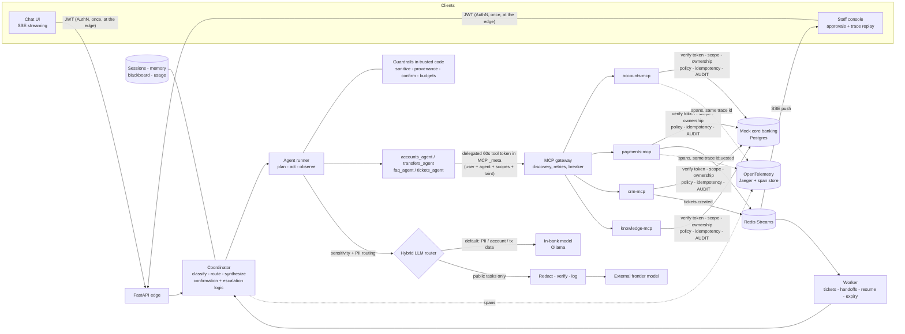

# bankai - a multi-agent banking assistant built to be operated, not demoed

Customers and staff talk to one assistant that checks balances, moves money, answers policy questions, files tickets and hands off to a human. A coordinator routes to four specialist agents; every capability is an **MCP tool server**; **the tool layer, not the model, decides what is allowed**. The core banking systems are mocked (no real bank APIs); the interfaces are realistic.

```bash
make up            # Postgres + Redis + Jaeger + 4 MCP servers + API + worker.  UI http://localhost:8080  staff /staff  traces :16686
make test          # 181 tests, no Docker needed
make eval          # 44 golden conversations (+2 known failures) -> evals/reports/report.md, exit 1 on regression
make demo          # attack failing / authz denial / runaway loop / HITL approval / multi-agent vs monolith / PII egress
```
No `make` (Windows)? `.\run.ps1 up|test|eval|demo|smoke`. Demo logins (dev IdP, `ENV=dev` only): `alice`, `bob` (customers), `tina` (teller), `sam` (approver).

## What has and has not been verified

| Verified here | How |
|---|---|
| All logic, guardrails, authz, idempotency, budgets, HITL, queues | 181 automated tests (`make test`) |
| Agent behaviour end to end (routing, tool choice, denials, PII, injection, loops, outages) | 44 golden evals + 2 deliberate known failures; 11 meta-tests prove the evals go red when prompts or code are sabotaged |
| The **deployed** stack: Postgres, Redis Streams, MCP over HTTP, worker resume, Jaeger, degradation and self-heal | `scripts/smoke.py` - 22 checks passed against `docker compose` on Windows/Docker Desktop |
| Real in-bank model (`qwen3:8b` via Ollama) | Driven by hand end to end (typos, `1400$`, lower-case names, Roman Urdu such as "bob ko savings se 2000 bhej do"). It found real problems that the mocks could not: reasoning mode eating the token budget (fixed: `think:false`), the model guessing a destination account (fixed: trusted payee prefetch + destination-mismatch guard + confirmation text built by code), and the model narrating a confirmation instead of calling the tool (fixed: one runtime nudge). **Not** verified: the full eval suite against the real model (`make eval-real`, slow), the external Anthropic client against the live API (no key), and injection resistance of a real model. |

The mock is deliberately adversarial (`gullible=True` obeys any injected instruction) so the deterministic layers are tested against the **worst** model, not a friendly one.

## Architecture



A risky transfer, end to end (this is `make demo-hitl`):

```mermaid
sequenceDiagram
  participant C as Customer
  participant O as Coordinator
  participant T as transfers_agent
  participant P as payments-mcp
  participant Q as Redis Streams
  participant S as Staff (approver)
  C->>O: "Transfer $1500 from savings to Bob"
  O->>T: route (LLM classify)
  T->>P: initiate_transfer (guard intercepts)
  Note over T,O: ActionGuard: pending_transfer=awaiting_confirmation, NOT executed
  O-->>C: "Please confirm exactly this transfer"
  C->>O: "yes"  (regex on the customer's own message; the model cannot set it)
  T->>P: initiate_transfer (params match) + runtime-derived idempotency key
  P->>P: verify token, ownership, limits, risk = amount_over_threshold
  P-->>T: pending_approval (no funds moved) + audit row
  P->>Q: approvals.requested
  T-->>C: "needs a quick staff review" (paused run persisted)
  Q-->>S: SSE push to staff console
  S->>P: decide_approval (approver role, not the initiator)
  P->>Q: approvals.decided
  Q->>O: worker resumes the paused conversation
  O-->>C: notification "approved and completed"
```

## Where each of the 12 requirements lives, and how it is tested

| # | Component | Code | Proven by |
|---|---|---|---|
| 1 | Baseline: chat UI, agent loop, swappable LLM | `api/static/`, `agents/runner.py`, `llm/base.py` + `providers/` | `test_api.py`, `test_providers.py`, browser check |
| 2 | Multi-agent split | `agents/registry.py`, `agents/coordinator.py` | `demos/why_multi_agent.py` (measured tokens + blast radius), `test_injection.py::blast_radius` |
| 3 | Tools via MCP | `servers/definitions.py`, `mcp_layer/gateway.py` (discovery, no tool imports in agents) | `test_tools.py::agents_discover_tools_over_mcp...` |
| 4 | AuthN vs AuthZ | `security/{authn,authz,tool_tokens}.py`, `servers/common.py` | `test_auth.py` (17), `test_tools.py`, `demos/authz.py` |
| 5 | Sessions, memory, blackboard | `state/sessions.py` (SWE), `state/memory.py` (AI eng), `state/blackboard.py` | `test_state.py` (13) |
| 6 | Hybrid LLM + PII | `pii.py`, `llm/router.py`, `llm/guarded.py` | `test_hybrid_pii.py` incl. **`no_raw_pii_ever_reaches_the_external_client`**, `demos/pii_egress.py` |
| 7 | Prompt-injection guardrails | `guardrails/sanitize.py`, `guardrails/actions.py`, tool policy in `bankcore/services.py` | `test_injection.py` (34, marked `canary`: `make canary`), `demos/attack.py` |
| 8 | Eval pipeline | `evals/golden.yaml`, `evals/runner.py`, `evals/break_prompt.py` | `test_evals.py` (11), `docs/eval-report.md`, `docs/eval-regression-report.md` |
| 9 | Observability | `obs/tracing.py`, `cli.py replay`, `/debug/traces/{id}` | `test_api.py::trace_replay`, `::no_raw_pii_in_traces`, Jaeger in smoke |
| 10 | Cost + loop protection | `cost.py`, `agents/runner.py` | `test_cost_loops.py` (10), `demos/runaway.py` |
| 11 | Queues + HITL + idempotency | `queueing/`, `bankcore/idempotency.py`, `state/pauses.py` | `test_hitl_queue.py` (14), `demos/hitl.py`, smoke step 5-6 |
| 12 | Deployment + failure handling | `Dockerfile`, `docker-compose.yml`, `resilience.py`, `config.py` | `test_resilience.py` (12), `scripts/smoke.py` step 8 |

**Guardrail -> test map** (what fails if you break it): tool-layer authz -> `test_tools.py`, evals `authz-*`; provenance / confirmation gate -> `test_injection.py::layer3a/3b`; sanitiser -> the 10-phrasing canary corpus (zero-width splits, full-width look-alikes, delimiter spoofing); PII egress -> `test_hybrid_pii.py`, invariant checked in *every* eval case; loop protection -> `test_cost_loops.py`, evals `bud-*`; HITL -> `test_hitl_queue.py`, evals `hitl-*`; audit tamper-evidence -> `test_tools.py::audit_chain_detects_tampering`.

## Security model in one screen

1. **AuthN once, at the edge.** A verified JWT (algorithm pinned, `exp/iss/aud/sub` required) becomes an `Identity`. Nothing downstream accepts identity from a body, header or model output.
2. **Delegated identity, not forwarded credentials.** The runtime mints a 60-second token per tool call: user, roles, *agent*, the tool names that agent may call, audience = one MCP server, and the turn's risk flags ("taint"). It travels in MCP `_meta`, so it is never in the tool schema the model sees.
3. **Tools enforce.** Each MCP server verifies the token, checks the tool is in the agent's scope, re-derives ownership from the ledger, applies transfer policy (limits, new payee, drains-80%, velocity, tainted context), requires an idempotency key on mutations, and writes a hash-chained audit row - allow, deny or error.
4. **The model proposes, trusted code disposes.** Before a call leaves: allow-list, no smuggled arguments, *provenance* (an account number must come from what the customer typed, their verified accounts, saved payees or trusted memory - not from a document), and an explicit customer confirmation of the exact transfer.
5. **Untrusted data is data.** Every tool result is sanitised (NFKC, invisible characters, instruction patterns removed) and wrapped in `<untrusted_data>`.
6. **PII stays in.** Default route is the in-bank model. External only for allow-listed public tasks with no restricted data, no high-sensitivity PII, redaction, a re-scan that fails closed, and an egress log.
7. **Bounded blast radius.** Each agent owns only its tools; per-request token/cost/iteration/identical-call/depth budgets; per-user daily cap.

## Configuration and secrets

Settings are environment variables (`bankai/config.py`, all documented in `.env.example` / `docker-compose.yml`). Secrets are **files** mounted at `/run/secrets` (`make secrets` generates random ones; nothing in git, nothing in env vars, the Postgres password is injected from the secret store and never appears in `DATABASE_URL`). Outside `ENV=dev` a missing secret is a startup failure - there are no well-known fallback keys (enforced by `test_no_secret_material_in_source...`).
If your checkout sits somewhere Docker cannot bind-mount (sandboxed or virtualised paths - this happened while building this), use `make up-env`, which sources the same secrets from environment variables.

Useful switches: `EXTERNAL_LLM_ENABLED=false` (nothing ever leaves the bank), `LOCAL_LLM_PROVIDER=ollama` with `docker compose --profile local-llm up`, `EXTERNAL_LLM_PROVIDER=anthropic` + `secrets/anthropic_api_key` (still behind the PII guard).

## Operating it

* Replay any turn: the chat footer shows a trace id -> staff console **Trace replay**, `GET /debug/traces/{id}?format=text`, `make replay TRACE=<id>`, or Jaeger. Spans carry agent, route reason, tool args/results (PII-masked), tokens, latency and cost.
* Cost: `GET /usage` (approver sees per agent/user/provider), `python -m bankai.cli usage agent`.
* Audit: `GET /debug/audit`, `python -m bankai.cli audit-verify`.
* Failure behaviour: every LLM and MCP call has a timeout, backoff-and-jitter retries for transient faults only, and a circuit breaker. `/readyz` actively probes the tool servers and reports `degraded`; stopping `payments-mcp` leaves balances, FAQs and tickets working (smoke step 8).

## Known limits and what production would still need

* **Mock models** (above). The eval suite is a plumbing-and-guarantees regression suite until you point it at a real model.
* **Dev IdP.** `/auth/dev-token` exists only when `ENV=dev`. Production needs a real OIDC provider (RS256 + JWKS; the verification path is already algorithm-pinned) and an STS that mints the tool tokens with an asymmetric key; here it is an HS256 shared secret.
* **Sanitiser and PII detector are heuristics** (regex, Luhn, dictionary of customer names). Put NER (e.g. Presidio) behind the same interfaces; the fail-closed re-scan stays as the verifier. The sanitiser is layer 1 of 4 on purpose.
* **Sticky taint.** Once hostile text is seen in a session, later transfers in it need human review. Conservative by design; it means a customer whose statement contains a poisoned description is reviewed more often. Quarantining hostile data upstream is the real fix.
* **Residual injection risk the tool layer alone cannot remove:** an injection targeting an already-known payee with a small amount is indistinguishable from intent at the ledger. Layers 1 and 3 (sanitiser, provenance, explicit confirmation) exist for exactly that; `demos/attack.py` says so.
* **Answers stream after the output guard.** The UI streams the *finished, guarded* answer in chunks; token-level streaming from the model is not passed through, because the output guard must see the whole text first.
* **Publish-after-commit events** (at-least-once, idempotent consumers) rather than a transactional outbox.
* **Synchronous DB calls inside async code** - fine at demo scale; use an async driver or a thread pool at load. Not load-tested.
* No rate limiting at the edge (cost caps bound spend, not request rate); no multi-region or backup story.

See `DECISIONS.md` for the reasoning and the alternatives rejected, component by component.

## Layout

```
bankai/  api/ (FastAPI, UI)  agents/ (registry, runner, coordinator)  llm/ (base, router, guarded, providers)
         servers/ (4 MCP servers)  mcp_layer/ (gateway)  bankcore/ (mock bank: services, audit, idempotency, seed)
         security/ (authn, authz, tool tokens)  guardrails/ (sanitize, actions)  state/ (sessions, memory, blackboard)
         queueing/ (queue, worker)  obs/ (tracing)  prompts/ (versioned .md)  cost.py resilience.py pii.py config.py
evals/   golden.yaml  runner.py  break_prompt.py        demos/  six runnable scripts        tests/  181 tests
docs/    eval-report.md  eval-regression-report.md  demo-output/*.txt
```
